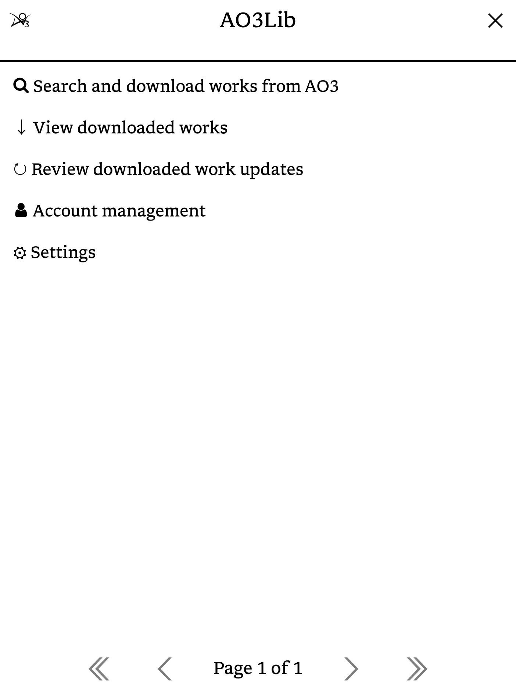
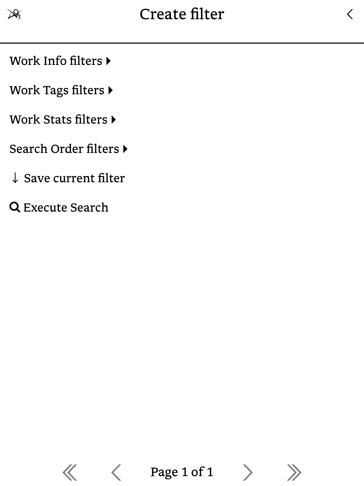
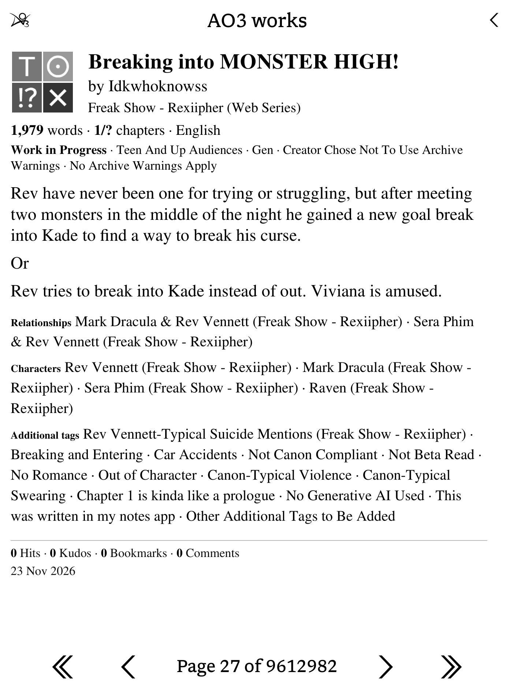
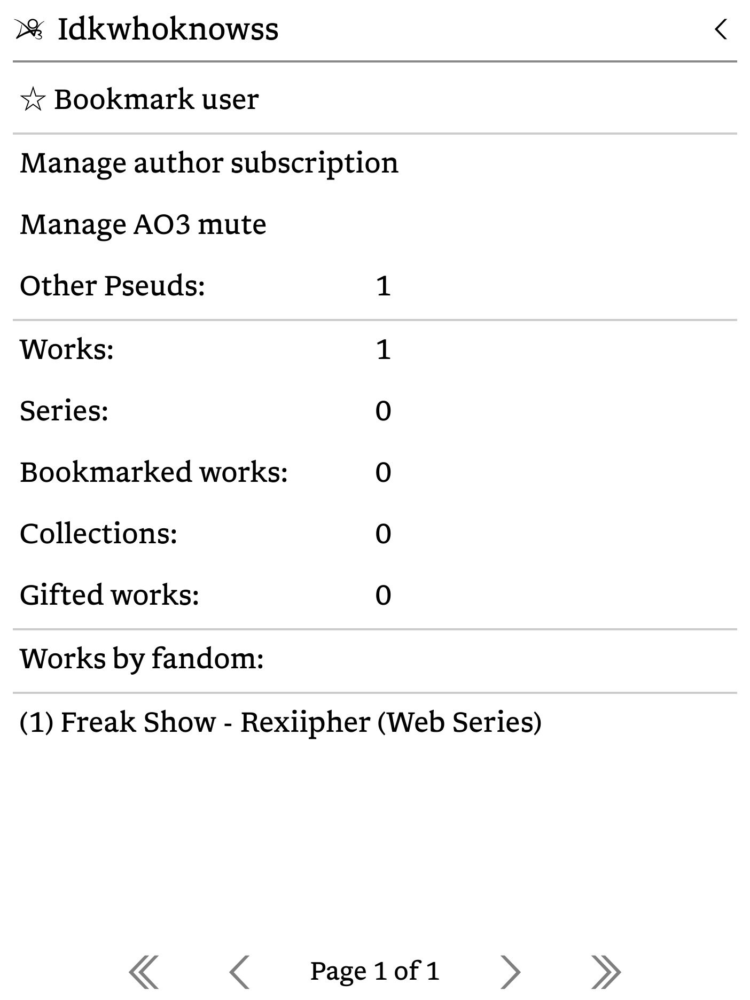
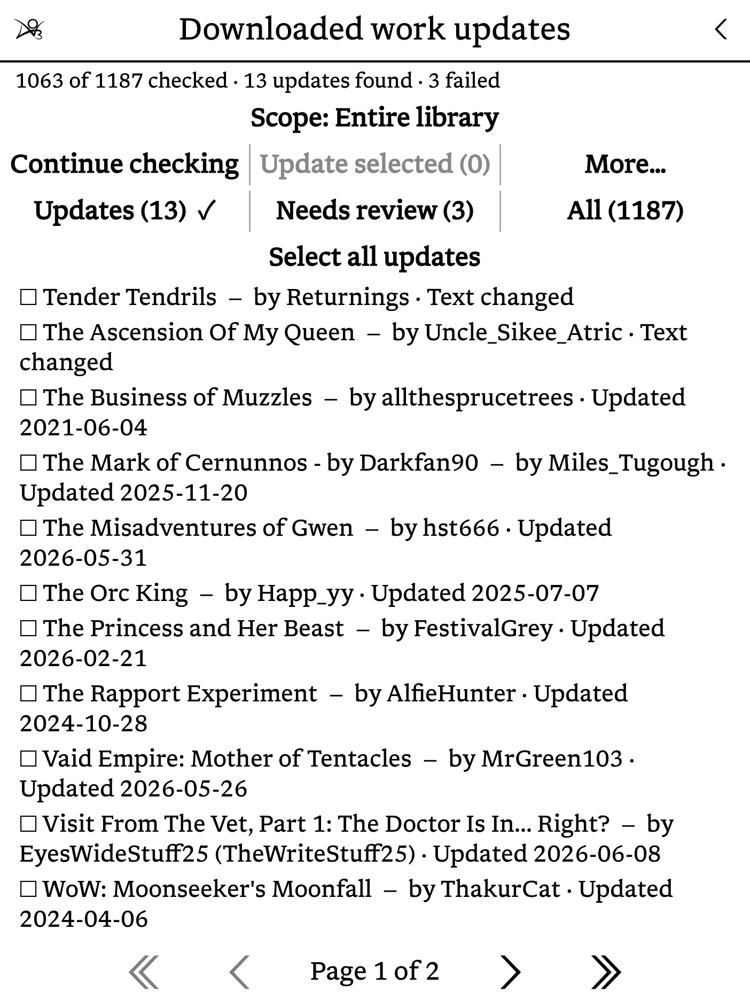
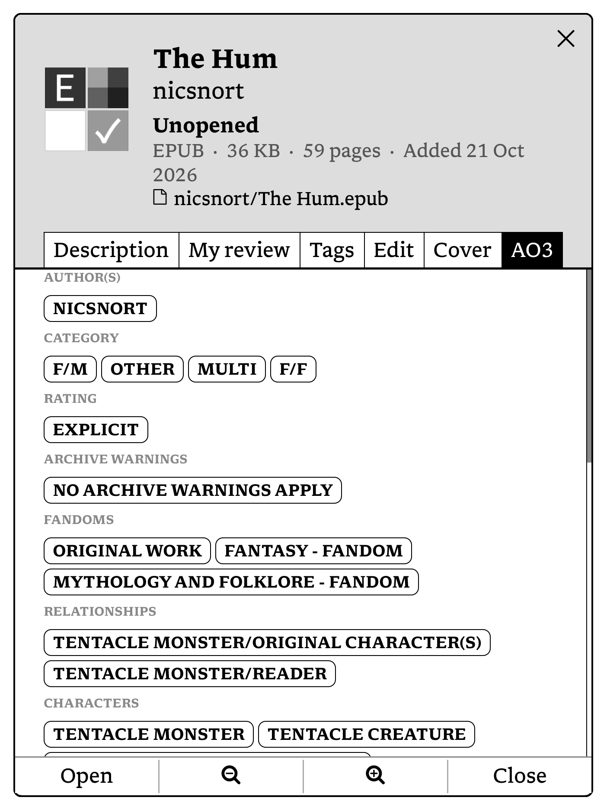
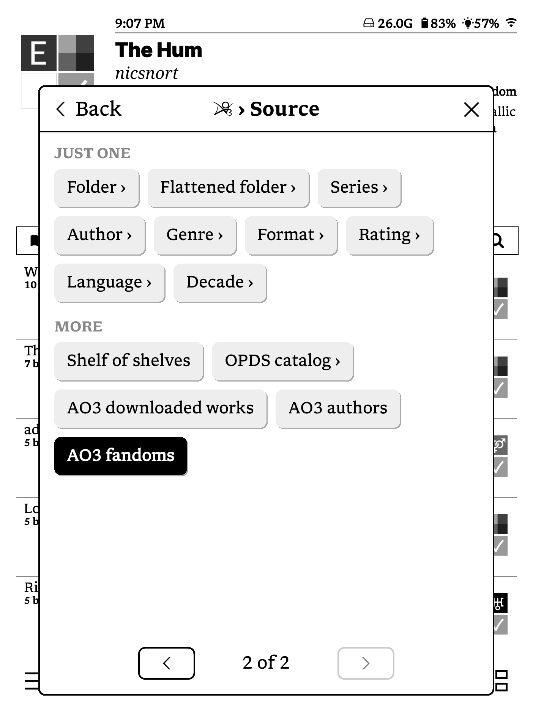
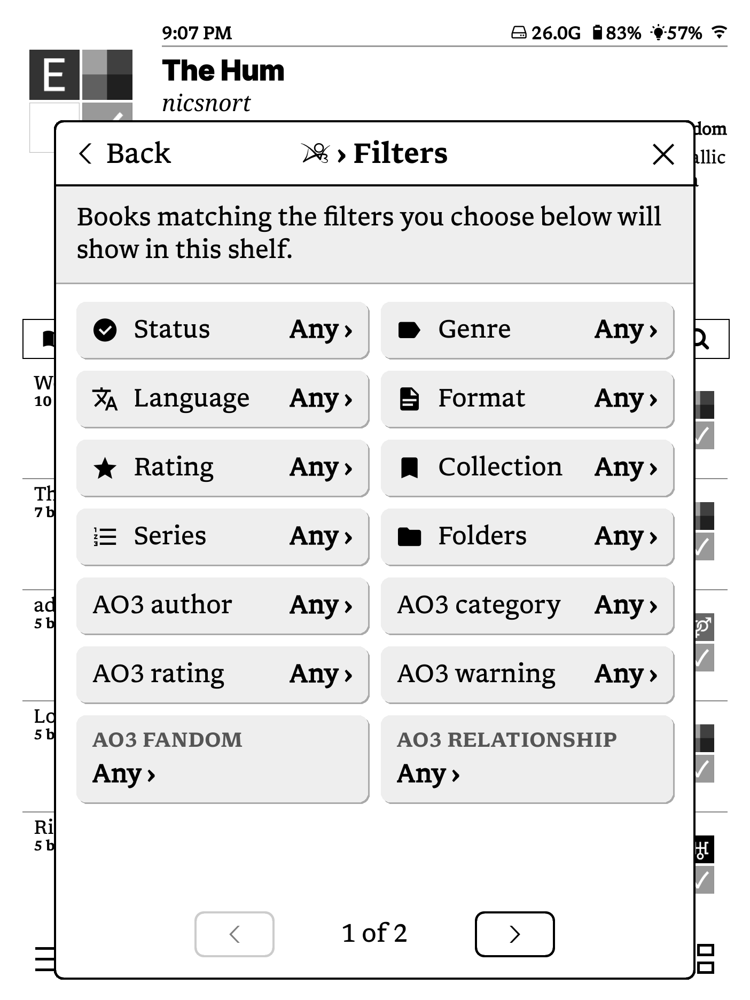
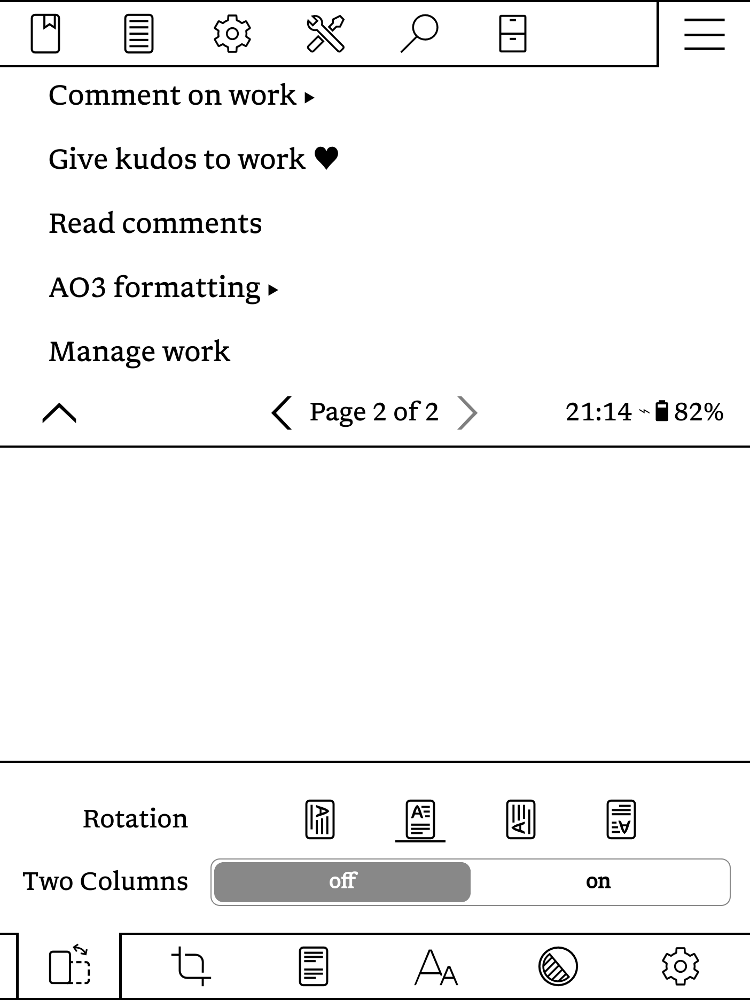

# AO3Lib for KOReader

An unofficial plugin for browsing, downloading, and reading works from Archive of Our Own. This fork of [IntrovertedMage's original plugin](https://github.com/IntrovertedMage/AO3Downloader.koplugin) focuses on managing a local AO3 library and integrating with Bookshelf.

## Features

- Search AO3 by tags or detailed filters, download by work ID, and browse authors, series, collections, and bookmarks.
- Bookmark works, give kudos, manage subscriptions, and read, write, and reply to comments.
- Discover downloaded AO3 EPUBs in the configured download folder and KOReader home folder, and browse them offline by author or fandom.
- Organize existing downloads while preserving reading progress and associated work data.
- Review available updates before replacing downloaded EPUBs, with reading progress preserved.
- Optionally convert HTML downloads to EPUB when native downloads are unavailable, and replace conversions with native EPUBs later.
- Access AO3 metadata and filters from Bookshelf work details, with AO3 symbol placeholders for works without covers.

AO3 works are identified from metadata inside their EPUBs, including works downloaded outside this plugin. Local reading and library browsing remain available when AO3 is offline.

## Screenshots

| Main menu | Search filters | Work details |
| :---: | :---: | :---: |
|  |  |  |
| **Author profile** | **Update review** | **Bookshelf AO3 details** |
|  |  |  |
| **Bookshelf sources** | **Bookshelf filters** | **Reader actions** |
|  |  |  |

## Install

The preferred method is to install **AO3Lib** through [Storefront](https://github.com/ultimatejimmy/storefront.koplugin) directly in KOReader.

For manual installation:

1. Download [the latest release](https://github.com/GallowsDove/AO3Lib.koplugin/releases/latest/download/AO3Lib.koplugin.zip).
2. Extract the ZIP into KOReader's `plugins` directory. It contains the `AO3Lib.koplugin` folder.
3. Restart KOReader, then open **AO3Lib** from the file manager's Search menu.

Typical plugin locations:

| Device | Plugins folder |
|--------|----------------|
| Kindle | `/mnt/us/koreader/plugins/` |
| Kobo | `/mnt/onboard/.adds/koreader/plugins/` |
| Android | `<koreader-dir>/plugins/` |

For manual updates, replace the plugin folder and restart KOReader. Bookshelf integration is optional and requires a compatible version of [Bookshelf](https://github.com/AndyHazz/bookshelf.koplugin).

## Credits

Original plugin by [IntrovertedMage](https://github.com/IntrovertedMage/AO3Downloader.koplugin). The missing-cover badge design is inspired by [AO3 Plus](https://github.com/gin7uro/koreader-ao3-plus), using AO3's official symbols; asset sources and license are included in [assets/ao3-icons](assets/ao3-icons).

Additional symbol styles by [ZerafinaCSS](https://github.com/ZerafinaCSS/Replace-the-AO3-Icons-2.0) (MIT).
